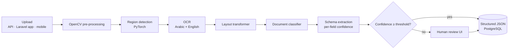

# Document Vision Intelligence

**Intelligent document and vision processing.** Object detection, OCR, layout analysis, transformer-based classification and structured extraction for Arabic and English documents.

> **Building in public.** The architecture and roadmap are published first. Code, benchmarks and results land milestone by milestone. Watch the repo to follow along.

## Problem

Invoices, receipts, contracts and ID documents still get processed by hand. They are semi-structured, often scanned or photographed, and mix Arabic and English. That creates backlogs and data-entry errors.

## Solution

A pipeline that turns a photo or scan into validated JSON:

1. **Pre-processing** with OpenCV: deskew, denoise, perspective correction, contrast normalization
2. **Object detection** of regions (tables, stamps, signatures, logos, ID fields)
3. **OCR** tuned for Arabic + English
4. **Layout analysis** with layout-aware transformers (text + position + image)
5. **Document classification** (invoice, receipt, contract, ID, other)
6. **Structured extraction** into typed schemas, with per-field confidence
7. **Validation & review**: low-confidence fields go to a human review queue

## Architecture

## Tech stack

| Layer | Technologies |
| --- | --- |
| Vision | OpenCV, PyTorch object detection |
| OCR | OCR engines with Arabic support (e.g. PaddleOCR / Tesseract), post-correction |
| Understanding | Hugging Face Transformers, layout-aware models, transformer-based classification |
| Extraction | Typed schemas (Pydantic), LLM fallback for free-form fields |
| Serving | Python, FastAPI, GPU inference workers |
| Platform | Docker, Kubernetes |
| Review | Next.js review UI, Laravel integration |

## Targets and how they are measured

| Target | Metric | Method | Result |
| --- | --- | --- | --- |
| +22% extraction accuracy vs. OCR + regex baseline | Field-level F1 | Labeled AR/EN document set | pending |
| ~60% less manual processing | % documents auto-approved | Confidence-threshold study | pending |
| Horizontal scaling | Docs / minute per GPU | Load test on Kubernetes | pending |

## Roadmap

- [x] Architecture and design document
- [ ] Labeled AR/EN sample dataset (synthetic + public)
- [ ] OpenCV pre-processing module
- [ ] OCR + layout pipeline
- [ ] Classifier and schema extraction
- [ ] Confidence scoring and review UI
- [ ] GPU inference service on Kubernetes
- [ ] Benchmark report

---

Built by [Mohammed Al-Mekhlafi](https://github.com/m-makhlafi) · Full-Stack & AI Engineer
